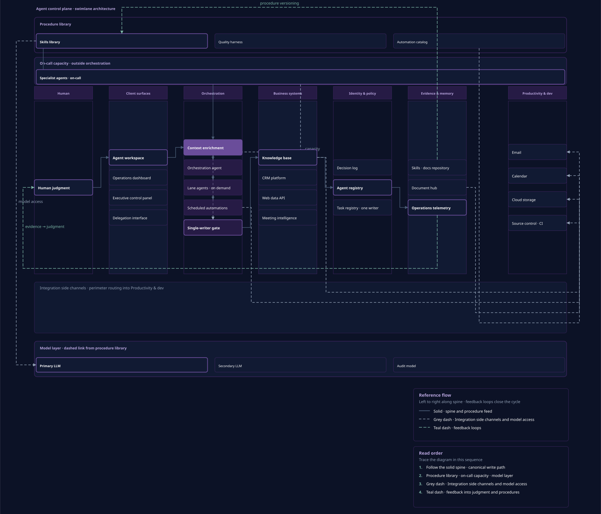

  

# Clinton Pracher: Enterprise Product Leader

**I build the decision systems underneath products, so teams can move faster without losing control.**

My work spans enterprise platforms, data, and AI. I connect business strategy, investment decisions, and engineering delivery, particularly when the organization has become more complex than the systems supporting it.

## What I build

I've always been the person asking, “Is there a better and easier way to do this?”

I'll follow the process and map it out first. I want to understand how things actually work before deciding what needs to change. That includes talking to the people doing the work, not just reading the roadmap or looking at the dashboard.

Across my career, I've repeatedly worked where the business grew faster than its systems, responsibilities, and ways of working could keep up. The industries changed. The work underneath them didn't.

At one organization, that meant bringing 45 fragmented data sources into a shared view of media investment. In another, it meant leading an AI portfolio across more than 100 regulated markets. Elsewhere, product and engineering needed a clearer way to make commitments against a fixed seasonal deadline.

Those situations require more than another feature. Teams need agreement on what the numbers mean, what deserves investment, who owns the decision, and what they can realistically deliver.

I work across finance, operations, sales, analytics, engineering, delivery, and product leadership because those questions rarely belong to one function. My job is to connect the business need to the product direction, make the tradeoffs explicit, and give teams a workable path forward.

I also build. In my own operating system, I've implemented versioned skills, governed automations, publishing workflows, and agent execution with defined authority. That work lets me apply the same thinking directly, from the business goal through implementation and verification.

I want to leave behind more than a shipped product. The people running it should understand how it supports the business, what they own, and how to move it forward without every decision returning to the same person.

## Explore

Rendered site pages assemble Liquid templates that GitHub does not render. Use the website for complete pages; use the repo paths for case studies, resume downloads, and source.

| Section | Best destination | Repo source |
| ------- | ---------------- | ----------- |
| [**About**](https://clintonpracher.com/about/) | Website | `content/about/` |
| [**Work**](https://clintonpracher.com/work/) | Website | [Case studies](work/case-studies/) |
| [**Skills**](https://clintonpracher.com/work/skills/) | Website | `work/skills.md` (site template) |
| [**Thought Leadership**](https://clintonpracher.com/thought-leadership/) | Website | `thought-leadership/` · `writing/` |
| [**Resume**](https://clintonpracher.com/resume/) | Website · [downloads](resume/README.md) | PDF / DOCX / TXT in `resume/` |

## Proof points

These examples show different parts of my work. Each result belongs to the role and context described in its case study.

| Work                              | My role                                                                                   | Scale and documented results                                                                                                                                  | Read more                                                                                    |
| --------------------------------- | ----------------------------------------------------------------------------------------- | ------------------------------------------------------------------------------------------------------------------------------------------------------------- | -------------------------------------------------------------------------------------------- |
| Enterprise marketing intelligence | Led product work across data definitions, platform architecture, and reporting governance | 45 data sources consolidated; 95% of $600M in annual media investment unified on one platform; decision time reduced 40%; reporting across 140 markets        | [Data Unification](work/case-studies/enterprise/data-unification.md)                         |
| Enterprise AI portfolio           | Led portfolio priorities and reusable privacy and go-to-market decision frameworks        | 13 AI products shipped across 100+ regulated markets; $8M budget; 60+ engineers and program leads; no reported regulatory incidents in the documented rollout | [AI in Regulated Markets](work/case-studies/enterprise/ai-regulated-markets.md)              |
| Connected hardware and software   | Led a 30-day product operating-model diagnostic and redesign                              | $120M line of business; requirements clarification reduced from two weeks to two days; engineering rework reduced from 40% to zero during the observed window | [Product System Stabilization](work/case-studies/enterprise/product-system-stabilization.md) |
| My operating system               | Personally designed and implemented governed skills, automations, and agent workflows     | An internal system connecting goals, execution ownership, approval boundaries, and recorded evidence                                                          | [Operator Control Plane](work/case-studies/operator/control-plane.md)                        |

## How I put this into practice

My operating system gives me a place to apply and test the principles I use in enterprise leadership.

Work has an owner. Agents have defined permissions. Changes go through version control and checks. Results need evidence, and decisions that require my judgment come back to me.

The purpose is to carry repeatable work without making me the coordinator for every exception. I use GitHub to make that work inspectable through repositories, pull requests, versioned procedures, and publishing workflows.

The diagrams below show the architecture behind it.

<strong>Operating architecture at a glance</strong>

[Open the full-size architecture diagram](assets/diagrams/architecture-one-glance.svg)

<strong>How authority and execution flow</strong>

[Open the full-size swimlane diagram](assets/diagrams/architecture-agent-control-plane-swimlanes.svg)

## How I can help

I help executives at companies built through acquisition achieve numbers nobody argues about, a room they are never surprised in, and a business that is easier to run and easier to sell, so they can stop defending their reporting and start leading with authority.

The companies may have come together while their reporting, priorities, and ways of working remain separate. I bring product leadership to that problem, connecting what executives need to achieve with the platforms, data, responsibilities, and investment decisions required to get there.

Sometimes the answer is a platform change. Sometimes it is a clearer product direction or agreement on who owns the next decision. I want to understand that before asking a team to build something.

That is the work I bring to enterprise platform, data, and AI leadership: helping the organization make better decisions and giving its teams the structure to carry them through.

## Contact

Based in Las Vegas. Open to remote US roles and local hybrid opportunities.

[LinkedIn](https://www.linkedin.com/in/clinton-pracher) · [Clint's Call](https://clintscall.substack.com) · [Email](mailto:clintonpracher@gmail.com)

**Portfolio:** [clintonpracher.com](https://clintonpracher.com/)
